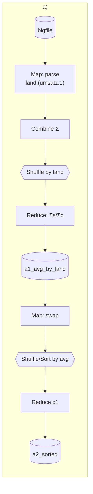
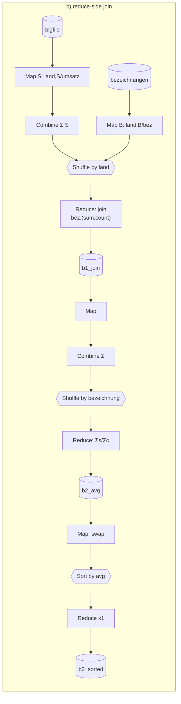
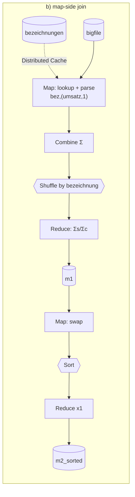

# MapReduce Demo – FFHS BDN, Aufgabe MapReduce (Gruppe Rot)

Java MapReduce jobs equivalent to

```sql
-- a)
SELECT land, AVG(umsatz) FROM bigfile GROUP BY land ORDER BY 2;
-- b)
SELECT bezeichnung, AVG(umsatz) FROM bigfile, bezeichnungen
WHERE bigfile.land = bezeichnungen.land GROUP BY bezeichnung ORDER BY 2;
```

Verified: output is identical to SQLite for all three variants (a, b reduce-side join, b map-side join).

## Quick start

```powershell
# existing cluster: just run (auto-detects the namenode container)
.\run-demo.ps1

# no suitable cluster? start the reference one first
cd docker; docker compose up -d; cd ..
.\run-demo.ps1
```

All settings (rows, reducers, memory, variants, container name) are in the config block at the top of `run-demo.ps1` / `run-demo.sh`.
The script generates the data **inside** the container (no Java needed on the host), uploads it to HDFS, runs the jobs on YARN and prints the results.

| Path in HDFS | Content |
|---|---|
| `/demo/input/bigfile/bigfile.csv` | sales data |
| `/demo/input/bezeichnungen/bezeichnungen.csv` | lookup land → bezeichnung |
| `/demo/out/a/a1_avg_by_land`, `.../a2_sorted` | a) step 1 / final |
| `/demo/out/b/b1_join`, `b2_avg_by_bezeichnung`, `b3_sorted` | b) reduce-side join steps |
| `/demo/out/b-mapjoin/m1_mapjoin_avg`, `m2_sorted` | b) map-side join steps |

Show intermediate steps during the demo: `docker exec namenode hdfs dfs -cat /demo/out/b/b1_join/part-*`

## Assumptions about the data

| | |
|---|---|
| Format | CSV, `;` separator, UTF-8, header line, `.` as decimal point |
| `bigfile` | `id;datum;land;umsatz` – e.g. `4711;2026-03-14;CH;1234.50`, very large (HDFS blocks → many map tasks) |
| `bezeichnungen` | `land;bezeichnung` – small lookup table (one row per land) |
| `land` | ISO-like code, join key |
| `umsatz` | CHF, decimal. Empty = NULL → ignored by AVG (as in SQL) |
| Join | inner join: land without bezeichnung (XX) and bezeichnung without sales (LI) disappear |
| Mapping | **not necessarily 1:1** – GB and UK both map to "Vereinigtes Koenigreich" |
| Dirty data | ~0.1 % rows with empty or non-numeric umsatz → counter `MALFORMED` |
| Skew | CH/DE have far more rows than others (discussion: reducer skew) |

## Key idea: AVG is not associative

`avg(avg(x), avg(y)) ≠ avg(x ∪ y)` → mappers/combiners pass **(sum, count)**, the division happens exactly once in the reducer. This is what makes a **combiner** legal.

Proof from the demo data (1M rows): GB = 1293.49, UK = 1240.54
- wrong (avg of avgs): (1293.49 + 1240.54) / 2 = **1267.02**
- correct (sum/count): **1275.86** ← SQL and MapReduce

## Pseudocode

### a) `GROUP BY land ORDER BY avg`

```
JOB A1 – aggregate
  map(offset, line):
      if header or malformed: count and skip
      (id, datum, land, umsatz) = split(line, ";")
      emit(land, (umsatz, 1))

  combine(land, [(s1,c1), (s2,c2), ...]):        // map side, optional
      emit(land, (Σs, Σc))

  reduce(land, [(s1,c1), (s2,c2), ...]):
      emit(land, Σs / Σc)

JOB A2 – ORDER BY 2
  map(offset, "land \t avg"):  emit(avg, land)     // swap → shuffle sorts by avg
  reduce(avg, [land...]):       for land: emit(land, avg)
  (1 reducer → globally sorted)
```

### b) variant 1 – reduce-side join (repartition join)

```
JOB B1 – join on land
  mapS(offset, bigfile line):         emit(land, ("S", umsatz, 1))
  mapB(offset, bezeichnungen line):   emit(land, ("B", bezeichnung))

  combine(land, values):                          // pre-aggregate S, pass B through
      emit(land, ("S", Σumsatz, Σcount));  for each B: emit(land, B)

  reduce(land, values):
      bez = all "B" values;  (sum, count) = Σ of all "S" values
      if bez empty or count == 0: skip            // inner join
      for b in bez: emit(b, (sum, count))         // 1:n like SQL

JOB B2 – GROUP BY bezeichnung
  map(offset, "bez \t sum \t count"): emit(bez, (sum, count))
  combine: Σ ;  reduce(bez, pairs): emit(bez, Σsum / Σcount)

JOB B3 – ORDER BY 2   (same as A2)
```

Why B2? The shuffle key of the join is `land`, the GROUP BY key is `bezeichnung`. They only coincide if the mapping is 1:1 – see GB/UK in `b1_join` output.

### b) variant 2 – map-side join (broadcast / replicated join)

```
JOB M1
  setup():   lookup = load bezeichnungen.csv from Distributed Cache into HashMap
  map(offset, line):
      bez = lookup[land];  if none: skip          // inner join
      emit(bez, (umsatz, 1))
  combine / reduce: same as A1 → avg

JOB M2 – ORDER BY 2
```

Possible because `bezeichnungen` is tiny. One job less, no join shuffle.

## DAGs







**MapReduce ↔ DAG:** each MapReduce job is a fixed 2-stage DAG (map → shuffle → reduce). A query with several shuffles (join, group, sort) becomes a *chain* of jobs, with every intermediate result materialised in HDFS (`a1_…`, `b1_…`, `b2_…`). DAG engines (Tez, Spark) execute the same graph as one job, keeping intermediates in memory/local disk and pipelining stages – e.g. B2+B3 would be one stage boundary less.

**YARN during the demo (http://localhost:8088):** each job = one YARN application → ResourceManager starts an ApplicationMaster container on a NodeManager → AM requests containers for map tasks (one per input split, data-local if possible) and reduce tasks → when done, AM unregisters. Variant b runs 3 applications, map-join only 2.

## Expected results (default: 1'000'000 rows, seed 42)

| a) land | avg | | b) bezeichnung | avg |
|---|---:|---|---|---:|
| XX | 502.16 | | Spanien | 648.79 |
| ES | 648.79 | | Italien | 760.25 |
| IT | 760.25 | | Oesterreich | 870.18 |
| AT | 870.18 | | Belgien | 940.63 |
| BE | 940.63 | | Deutschland | 981.12 |
| DE | 981.12 | | Frankreich | 1017.48 |
| FR | 1017.48 | | Niederlande | 1177.16 |
| NL | 1177.16 | | Vereinigtes Koenigreich | 1275.86 |
| UK | 1240.54 | | Schweiz | 1451.29 |
| GB | 1293.49 | | Japan | 1744.00 |
| CH | 1451.29 | | Vereinigte Staaten | 2101.86 |
| JP | 1744.00 | | | |
| US | 2101.86 | | | |

XX only in a) (no bezeichnung), LI in neither (no sales).

## Troubleshooting

| Symptom | Cause / fix |
|---|---|
| `Could not find or load main class org.apache.hadoop.mapreduce.v2.app.MRAppMaster` | `HADOOP_MAPRED_HOME` not set for containers – the runner passes it via `-D`; permanent fix: the 3 `*.env` lines in `docker/config` / `mapred-site.xml` |
| Job hangs in `ACCEPTED` | Not enough NodeManager memory or AM limit. Lower `$ContainerMemMb` to 512, or raise `yarn.nodemanager.resource.memory-mb` and `maximum-am-resource-percent` (see `docker/config`) |
| Job runs but YARN UI is empty, log says `LocalJobRunner` | `mapreduce.framework.name` is `local` → set to `yarn` in `mapred-site.xml` |
| `Connection refused ... :8032` | No ResourceManager reachable from the container you run in – set `$Container` to a container that has the YARN config (or use the reference compose) |
| `UnsupportedClassVersionError` | Jar is built for Java 8+, so this should not happen; check `java -version` in the container |
| Safe mode | Runner waits with `hdfs dfsadmin -safemode wait`; if it never leaves, the datanode isn't connected (`hdfs dfsadmin -report`) |

## Files

```
mr-demo.jar                    prebuilt (Java 8 target, Hadoop 3.x)
run-demo.ps1 / run-demo.sh     runners
docker/docker-compose.yml      reference cluster (HDFS, YARN, JobHistory)
docker/config                  Hadoop settings for the reference cluster
pom.xml                        rebuild: mvn package
src/main/java/ch/ffhs/bdn/mr/
  AvgByLandJob.java              a)
  JoinAvgByBezeichnungJob.java   b) reduce-side join
  MapJoinAvgByBezeichnungJob.java b) map-side join
  SortByAvgJob.java              ORDER BY 2 (shared)
  Common.java, SumCountWritable.java
  DataGenerator.java             test data
  MrDemo.java                    entry point
```
